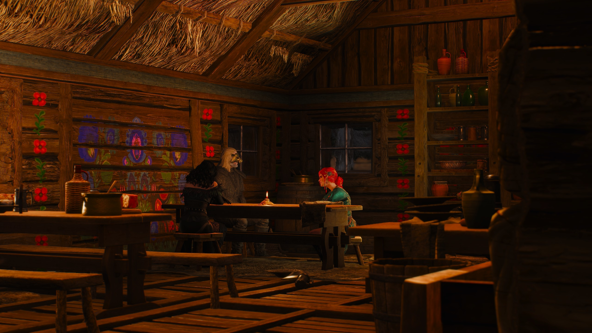
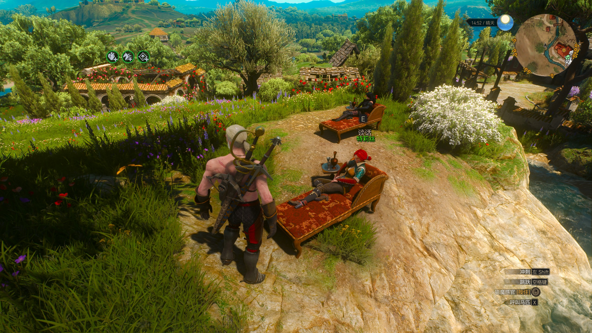

# Dual Romance / No Tango

《巫师3：狂猎》双恋爱模组，让杰洛特与特莉丝、叶奈法维持恋爱关系，并安排两人在结局与白鸦庄园共同出场。

## 功能

杰洛特与特莉丝、叶奈法同时维持爱情关系时，

- 跳过“三人探戈”的报复流程，继续后续主线；
- 主线结局依次播放叶奈法与特莉丝对应的片段；
- 希里女皇结局的酒馆开场中，杰洛特、叶奈法和特莉丝同桌而坐。沿用叶奈法分支的剧情演出；
- 血与酒 DLC 中，白鸦庄园依次进行两人的欢迎剧情，随后启动两人的常驻活动；
- 特莉丝使用另一个躺椅及配套家具，保留日常对话选项，夜间使用二楼房间床位。

## 效果图

  
  

## 设计

双恋爱内容以玩家已经确认的恋爱关系为触发条件，沿用游戏原有的选择结果。

单恋爱时，白鸦庄园沿用原有的床位、日常活动和家具布局。

庄园为两人分别安排动作点、对话站位和活动范围；需要占用同一演出空间的欢迎剧情依次进行。酒馆则使用专门的双恋爱布景，将特莉丝安排在同桌旁原有的第三张凳子上。单恋爱和无恋爱的酒馆演出沿用各自的原生分支。

剧情复用游戏已有的对白、配音和动画。特莉丝在酒馆开场中作为同桌角色出场，保留叶奈法分支的原有台词。

[安装与开发说明](docs/DEVELOPMENT.md)

原创代码与文档采用 [BSD-3-Clause](LICENSE)，游戏资源权利归原权利人，详见 [署名与许可范围](NOTICE.md)。
